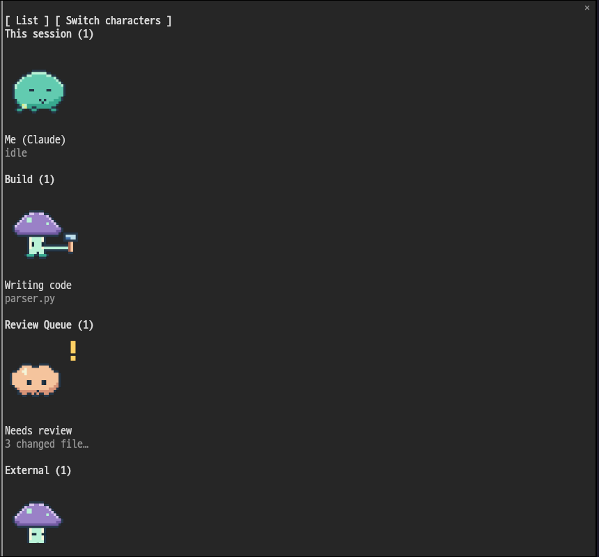

# Tamagent

[한국어](README.md) · [English](README.en.md) · [日本語](README.ja.md) · [中文](README.zh.md)

Small pixel companions move while your agents work. Tamagent is a Claude Code mod that displays the main agent and its active subagents in a panel. The name combines Tamagotchi and agent. Connect other tools with scripts that print JSON.




## Install

Requires a Claude Code build supporting function hook mods. This repository targets the 2.1.295 API and test engine. Enter this in the prompt of a terminal Claude Code session:

```text
/plugin install tamagent --marketplace Bum-Boo/tamagent
```

Answer `y` to `Add marketplace?`, choose a scope (`user` for personal use), and complete the configuration screen. Defaults work without external tools. The mod becomes active immediately. If the desktop Code tab does not support this install command, install in a terminal at user scope.

For local development, run `claude --plugin-dir /path/to/tamagent`.

## Use

```text
/tama
```

- The main agent works while a tool call is running and rests otherwise. Subagents work when `running`, rest when `pending`, `waiting`, or `idle`, and disappear when finished.
- **List** switches to a text list. **Characters** switches back to characters.
- **Switch characters** cycles through the current skin's characters. **Default characters** restores the configured mapping. This is a session preview; it does not write settings. The panel text is in English or Korean (see `language`).
- External agents are grouped by `group`. Character view shows up to two rows per section; use the list to see everyone. Closing the panel stops polling and animation.

Bundled assignments:

| Role | Character ID | Motif |
| --- | --- | --- |
| Main agent | `slime` | Green seed-bearing jelly |
| Subagent | `robot` | Small blue robot |
| External agent | `mushroom` | Purple mushroom |
| Group containing `queue` (case insensitive) | `cloud` | Peach cloud |
| Empty agent name, `unknown`, or `?` | `meteor` | Golden meteor with a trail |

## Configuration

Set these during installation or in Tamagent's `/config` entries. The engine reloads the mod after a configuration change. In settings files, values go under `pluginConfigs[plugin identifier].options`. For `--plugin-dir`, the identifier is `tamagent` (or `tamagent@inline`).

| userConfig field | Type | Default | Meaning |
| --- | --- | --- | --- |
| `sources` | string | `"[]"` | A **JSON array of argv arrays, encoded as a string** |
| `refreshSeconds` | number | `5` | Source polling interval, 1–3600 seconds; fractions allowed |
| `skin` | string | `"default"` | Skin folder name; `default` always uses bundled art |
| `characters` | string | `""` | Comma-separated `agent=characterID` pairs |
| `language` | string | `"auto"` | Panel language. `auto` checks `LC_ALL`, `LC_MESSAGES`, `LANG`: Korean for `ko*`, English otherwise. Set `ko` or `en` to pin it |

Example `options` object; change paths for your machine:

```json
{
  "sources": "[[\"python3\",\"/path/to/tamagent/examples/mock-agents.py\"],[\"python3\",\"/path/to/tamagent/examples/process-agents.py\"]]",
  "refreshSeconds": 5,
  "skin": "default",
  "characters": "claude=slime, codex=robot"
}
```

In the `sources` configuration input, enter `[["python3","/path/to/agents.py"]]` directly. Commands execute by argv without a shell. Paths containing spaces stay a single argument. `~`, `$HOME`, pipes, and redirects are not expanded. Use absolute paths or executable names on PATH. Commands inherit the current Claude Code session's working directory. They run repeatedly while the panel is open; configure trusted scripts that read state.

Mappings match agent names case insensitively: `claude` for the main agent, the type (e.g. `Explore`) for subagents, and the JSON `agent` for external entries. Role keys `main`, `subagent`, `external`, `queue`, and `unknown` apply to a whole role. Agent-name mappings take precedence. Unmapped agents in a custom skin use its first manifest character. A missing character ID falls back to the bundled character for that role.

Skin names and character IDs start with an ASCII letter or digit and contain letters, digits, `_`, or `-`, at most 64 characters. Invalid configuration is reported in the panel; valid entries and defaults continue working.

## External agent sources

Each command must print **one JSON array** to stdout and exit. Send diagnostic logs to stderr. No personal CLI or remote service is required.

```json
[
  {
    "id": "writer-1",
    "agent": "codex",
    "label": "Writing code",
    "detail": "parser.py",
    "state": "working",
    "group": "Project A"
  }
]
```

| Field | Contract |
| --- | --- |
| `id` | Required nonempty string, unique within that command's result |
| `agent` | Agent name; omitted or empty means `unknown` |
| `label` | First label line; defaults to agent name |
| `detail` | Second label line; defaults to empty |
| `state` | Required: `working`, `idle`, `stale`, `waiting`, or `failed` |
| `group` | Section name; omitted or empty puts the agent in the default **External** section |

Newlines and control characters are normalized to one line. Extra fields are ignored. IDs are namespaced per command, so different commands can reuse an ID. Equal group names merge across commands. Failed commands or invalid JSON produce an error line while other sources remain visible. Invalid rows are skipped individually.

| State | Pose | Appearance |
| --- | --- | --- |
| `working` | `work` | Working with a tool |
| `idle` | `idle` | Resting; eyes closed in the third frame |
| `stale` | `sleep` | Sleeping, Zz |
| `waiting` | `wait` | Yellow ! |
| `failed` | `alert` | Red ! |

A source can use just the Python standard library:

```python
import json

print(json.dumps([
    {"id": "build", "agent": "codex", "label": "Build",
     "detail": "Running tests", "state": "working", "group": "Development"}
]))
```

See the [synthetic source](examples/mock-agents.py) and [ps adapter](examples/process-agents.py). The latter reads the current user's executable names on Linux/macOS. OS process state only approximates actual agent activity.

## Replace characters

Download this repository or run the helper from the installed plugin directory. Importing requires Python 3 plus `ffmpeg` and `ffprobe` on PATH. Using the mod itself requires neither tool.

### Finding characters

A pet published in the Codex desktop pet v2 format (`pet.json` + `spritesheet.png`) imports with one command from step 1 below.

- Pet catalogs such as [Pets Codex](https://petscodex.com) or [Petdex](https://petdex.crafter.run)
- GitHub searches for `codex pet` or `codex desktop pet`; many repositories publish one ZIP per character in their releases
- Draw your own with a pixel editor such as [Aseprite](https://www.aseprite.org) or [Piskel](https://www.piskelapp.com), export PNG frames per pose, and use step 2

Many published pets are fan works of existing characters. Read each repository's terms (for example, no commercial use or redistribution) and use the art personally within those terms.

### 1. Import a Codex desktop pet v2

```sh
python3 tools/tamagent-skin.py import-codex-pet /path/to/pet-folder --skin my-pets --as a
python3 tools/tamagent-skin.py import-codex-pet /path/to/pet.zip --skin my-pets --as b
python3 tools/tamagent-skin.py import-codex-pet https://example.org/pet.zip --skin my-pets --as c
python3 tools/tamagent-skin.py list
```

The folder must contain `pet.json` beside `spritesheet.png`. A ZIP must contain exactly one pet with those two adjacent files, optionally nested in a folder. The v2 sheet is 8 columns × 11 rows of 192×208px cells, totaling 1536×2288px. Empty cells are skipped. Each crop is transparently padded to 208×208px and converted to a PNG and a 32×32 color grid.

| Source row | Cells | Tamagent pose |
| --- | --- | --- |
| 0 `idle` | 6 | `idle` |
| 5 `failed` | 8 | `alert` |
| 6 `waiting` | 6 | `sleep` |
| 7 `running` | 6 | `work` |
| 8 `review` | 6 | `wait` |

The pet's original `waiting` row represents resting, so **it differs from the external JSON `waiting` state**. Default frame duration is 150ms. Override with `--ms 200`, or use `--gif-dir /path/to/gifs` to read timings from local `idle.gif`, `failed.gif`, `waiting.gif`, `running.gif`, and `review.gif`. The pose-named GIF is also accepted when the source-state filename is absent. If a GIF's frame count differs from the row's cell count, the helper uses `--ms`.

### 2. Import your own PNG frames

```text
my-character/
  work-0.png
  work-1.png
  idle-0.png
  idle-1.png
  idle-2.png
  idle-3.png
  sleep-0.png
  sleep-1.png
  wait-0.png
  wait-1.png
  alert-0.png
  alert-1.png
  timings.json       # optional
```

Use square PNGs with transparent backgrounds. 32×32 suits pixel originals; 128×128 or 208×208 suits the image renderer. The helper copies the original PNG bytes and creates a separate 32×32 raster. Nonsquare images are padded for the raster, but image mode fills its 14×7 cell box and may distort their proportions.

Name files `<pose>-<number>.png` with lowercase poses and integer numbers. They are sorted numerically. Any positive frame count is allowed for a pose. Bundled art has work 2, idle 4 (third frame closes the eyes), and sleep/wait/alert 2 frames each, at 450ms per frame.

```sh
python3 tools/tamagent-skin.py import-frames /path/to/my-character --skin my-pets --as a --ms 150
```

For per-frame timing, put pose arrays in the source folder's `timings.json`. Values are 1–60000ms and array lengths must match the corresponding pose's files:

```json
{ "idle": [150, 150, 100, 250], "work": [150, 200] }
```

### 3. Configure the skin and mapping

Set `skin` to `my-pets` and `characters` to `claude=a, codex=b`. Assets are stored at `~/.local/share/tamagent/skins/<name>/`, using the runtime home directory. `default` is reserved for bundled art. Reimporting updates only the specified character and preserves others. Old PNG directories remain available and can be cleaned up later when unused.

Manifest example (`lo` must contain 1024 values in a real frame):

```json
{
  "lo": 32,
  "characters": {
    "a": {
      "idle": [
        { "file": "frames/a/idle-0.png", "lo": [-1, 1193046], "ms": 150 }
      ]
    }
  }
}
```

`lo` is a row-major 32×32 array; `-1` means transparent, other integers encode `0xRRGGBB`. `file` is relative to the manifest folder or an absolute path. A missing pose or unavailable file falls back to the character's `idle`, then the role's bundled character. After importing, close the panel and reopen it with `/tama` to load new files.

A manifest must fit the engine's 4MiB text-read limit. The helper writes compact JSON and, if the limit would be exceeded, preserves the installed manifest and asks you to split characters into another skin.


### Example: switch to the Chiikawa friends

[chiikawa-dots-pets](https://github.com/heelee912/chiikawa-dots-pets) is an unofficial fan work that packages 11 Chiikawa characters as Codex v2 pets. The original characters belong to Nagano (ナガノ) and the other rights holders, and that repository does not allow commercial use or redistribution. Tamagent does not include this art; the commands below download it from the original releases to your computer only.

```sh
git clone https://github.com/Bum-Boo/tamagent && cd tamagent
for c in chiikawa hachiware usagi kurimanju shisa; do
  python3 tools/tamagent-skin.py import-codex-pet \
    "https://github.com/heelee912/chiikawa-dots-pets/releases/download/v2.0.0/$c.zip" \
    --skin chiikawa --as "$c"
done
python3 tools/tamagent-skin.py list
```

Then set Tamagent's options as follows. Other characters (Momonga, Rakko and more) import the same way.

| Field | Value |
| --- | --- |
| `skin` | `chiikawa` |
| `characters` | `claude=chiikawa, codex=hachiware, hermes=usagi, subagent=kurimanju, external=kurimanju, queue=shisa, unknown=kurimanju` |

## Copyright

The distribution includes only original art created for Tamagent. Code and bundled art use the [MIT license](LICENSE). Check the rights holders' conditions for any other character artwork and use it personally only. Imported artwork does not automatically inherit the MIT license. It remains on your computer and is neither bundled with the mod nor uploaded by it. A URL import downloads the source ZIP from the address you specify.

## Terminals and limitations

- kitty/Ghostty use PNG `Image` elements at 14 columns × 7 rows, detected through `TERM`, `TERM_PROGRAM`, and `KITTY_WINDOW_ID`. Other terminals use 32 columns × 16 rows of half-cell blocks (`▀`, `▄`). Fonts, scaling, and the default background under transparent pixels affect the result.
- Screens without image/raster elements (including desktop) and narrow panes use the list. SSH or tmux can hide image support, leading to raster mode. PNG paths on a remote host may be unreadable by a local terminal.
- Main-agent `working` means a tool is running. Model thinking and response generation appear as `idle`. External state accuracy depends on your source scripts.
- Commands have an 8-second timeout and a 4MiB stdout limit. Sources run concurrently; polling skips a tick if the previous refresh is still running. Opening the panel waits for the initial read.
- Animation checks frame timing every 100ms and sends only changed frames through `$.ui.blit`. Short frames may be skipped. Skins load on panel open; there is no live file watcher.
- The mod API is early access. Builds without this API cannot run the mod; API changes require revalidation. Tamagent displays state and does not dispatch tasks or decide whether work is complete.

## Development and checks

```sh
python3 tools/make_sprites.py
python3 -m unittest discover -s tests -p 'test_*.py' -v
claude plugin validate .
claude plugin test .
tsc -p . --noEmit
```

A supported Claude Code build generates TypeScript declarations in `.claude-plugin/types/` when loading a development folder. Use your installed TypeScript's `tsc`. Original art is defined in [tools/make_sprites.py](tools/make_sprites.py); [hooks/characters.ts](hooks/characters.ts) is generated. HD/LO sheets and individual PNGs are generated under `tools/preview/` and ignored by Git.
