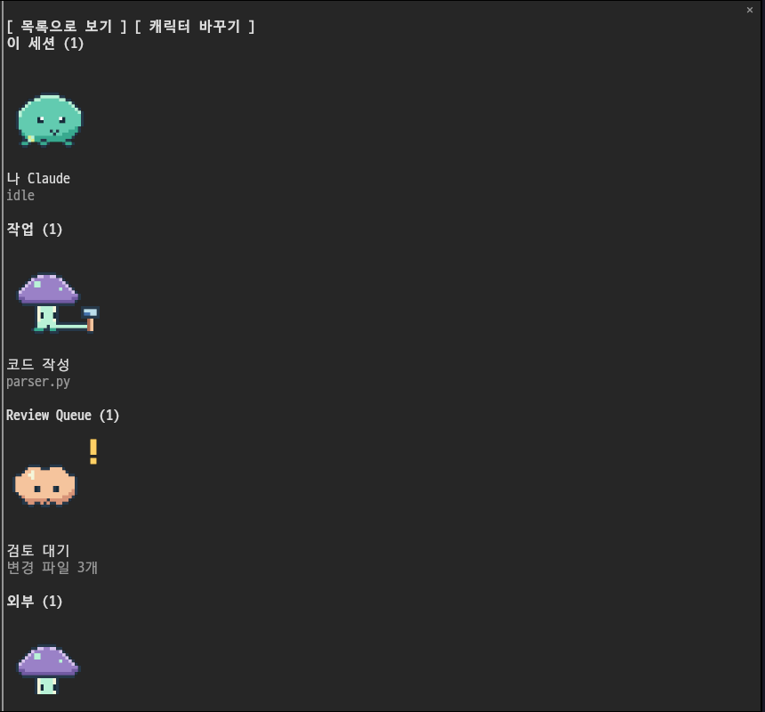

# Tamagent

[English](README.en.md)

에이전트가 일할 때 작은 도트 캐릭터도 움직여요. Tamagent는 Claude Code의 메인 에이전트와 서브에이전트를 보여 주는 개인용 관제 패널 mod예요. 이름은 다마고치와 에이전트에서 따왔어요. 외부 도구도 JSON을 출력하는 스크립트로 연결할 수 있어요.




## 설치

function hooks mod API를 지원하는 Claude Code가 필요해요. 이 저장소는 2.1.295의 API와 테스트 엔진을 기준으로 만들었어요. 터미널의 Claude Code 프롬프트에서 실행해요.

```text
/plugin install tamagent --marketplace Bum-Boo/tamagent
```

`Add marketplace?`에 `y`로 답하고 설치 범위(개인용은 user)를 선택해요. 이어지는 설정 화면에서는 기본값으로 시작해도 돼요. 설치하면 현재 세션에서 바로 활성화돼요. 데스크톱 Code 탭에서 설치 명령을 지원하지 않으면 터미널에서 user 범위로 설치해요.

개발 폴더에서 잠깐 실행하려면 `claude --plugin-dir /path/to/tamagent`를 써요.

## 사용

```text
/tama
```

- 메인 에이전트는 도구 실행 중에 일하고 그 밖에는 쉬어요. 서브에이전트는 `running`일 때 일하고 `pending`, `waiting`, `idle`일 때 쉬어요. 끝난 에이전트는 표시하지 않아요.
- **목록으로 보기**를 누르면 상태와 이름표를 글로 봐요. **캐릭터로 보기**로 돌아올 수 있어요.
- **캐릭터 바꾸기**는 현재 스킨의 캐릭터를 순서대로 바꿔 봐요. **기본 배정으로**를 누르면 설정의 매핑으로 돌아와요. 이 선택은 현재 세션의 미리보기이며 설정 파일에 저장하지 않아요.
- 외부 에이전트는 `group`별로 묶어요. 캐릭터 화면은 섹션마다 두 줄까지만 그리고 나머지 인원은 목록에서 봐요. 패널을 닫으면 갱신과 애니메이션도 멈춰요.

내장 캐릭터의 기본 배정이에요.

| 대상 | 캐릭터 ID | 모티프 |
| --- | --- | --- |
| 메인 | `slime` | 씨앗을 품은 초록 젤리 |
| 서브에이전트 | `robot` | 작은 파란 로봇 |
| 외부 에이전트 | `mushroom` | 보라 버섯 |
| `group`에 `queue` 포함(대소문자 무관) | `cloud` | 복숭아색 구름 |
| 에이전트 이름이 비어 있거나 `unknown`, `?` | `meteor` | 꼬리가 있는 금빛 유성 |

## 설정

설치 시 또는 `/config`의 Tamagent 항목에서 바꿔요. 설정을 바꾸면 엔진이 mod를 다시 읽어요. 파일로 지정하는 경우 `settings.json`의 `pluginConfigs[플러그인 식별자].options`에 넣어요. `--plugin-dir`로 실행할 때 식별자는 `tamagent`(또는 `tamagent@inline`)예요.

| userConfig 필드 | 형식 | 기본값 | 뜻 |
| --- | --- | --- | --- |
| `sources` | 문자열 | `"[]"` | **argv 배열들의 JSON 배열을 담은 문자열** |
| `refreshSeconds` | 숫자 | `5` | 소스 갱신 간격, 1~3600초(소수 가능) |
| `skin` | 문자열 | `"default"` | 스킨 폴더 이름. `default`는 항상 내장 그림 |
| `characters` | 문자열 | `""` | 쉼표로 구분한 `에이전트=캐릭터ID` 매핑 |
| `language` | 문자열 | `"auto"` | 화면 언어. `auto`는 `LC_ALL`·`LC_MESSAGES`·`LANG`을 보고 `ko`로 시작하면 한국어, 그 밖은 영어. `ko`·`en`으로 고정할 수 있어요 |

`options` 예시예요. 명령 경로는 본인 컴퓨터에 맞게 바꿔요.

```json
{
  "sources": "[[\"python3\",\"/path/to/tamagent/examples/mock-agents.py\"],[\"python3\",\"/path/to/tamagent/examples/process-agents.py\"]]",
  "refreshSeconds": 5,
  "skin": "default",
  "characters": "claude=slime, codex=robot"
}
```

`sources` 설정 칸에 직접 입력할 때는 `[["python3","/path/to/agents.py"]]`처럼 쓰면 돼요. 명령은 셸 없이 실행해요. 공백이 있는 경로도 하나의 인자로 전달돼요. `~`, `$HOME`, 파이프, 리다이렉션은 자동으로 해석하지 않으니 절대 경로나 PATH의 실행 파일을 써요. 명령의 작업 폴더는 현재 Claude Code 세션의 폴더예요. 설정한 명령은 패널이 열린 동안 반복 실행되므로 본인이 신뢰하는 읽기 전용 스크립트를 연결해요.

매핑은 대소문자를 구분하지 않는 에이전트 이름으로 찾아요. 메인은 `claude`, 서브는 타입 이름(예: `Explore`), 외부는 JSON의 `agent`예요. `main`, `subagent`, `external`, `queue`, `unknown` 키를 쓰면 대상 종류 전체에 적용해요. 에이전트 이름 매핑이 종류 매핑보다 우선해요. 사용자 스킨에서 매핑 없는 에이전트는 manifest에 처음 등록된 캐릭터를 써요. 없는 ID는 해당 대상의 내장 캐릭터로 대신해요.

스킨 이름과 캐릭터 ID는 영문·숫자로 시작하고 영문, 숫자, `_`, `-`를 써요(최대 64자). 잘못된 설정은 패널에 오류를 표시하고 기본값 또는 유효한 항목으로 계속해요.

## 외부 에이전트 연결

각 명령은 stdout에 **JSON 배열 하나**를 출력하고 종료해야 해요. 진단 로그는 stderr로 보내요. 별도 개인 CLI나 원격 서비스는 필요하지 않아요.

```json
[
  {
    "id": "writer-1",
    "agent": "codex",
    "label": "코드 작성",
    "detail": "parser.py",
    "state": "working",
    "group": "프로젝트 A"
  }
]
```

| 필드 | 규칙 |
| --- | --- |
| `id` | 필수. 비어 있지 않은 문자열, 같은 명령의 결과 안에서 고유해야 해요 |
| `agent` | 에이전트 이름. 생략·빈 문자열이면 `unknown` |
| `label` | 이름표 첫 줄. 생략하면 에이전트 이름 |
| `detail` | 이름표 둘째 줄. 생략하면 빈 문자열 |
| `state` | 필수. `working`, `idle`, `stale`, `waiting`, `failed` 중 하나 |
| `group` | 섹션 이름. 생략·빈 문자열이면 `외부` |

문자열 필드의 줄바꿈과 제어 문자는 한 줄에 맞춰 정리해요. 알 수 없는 추가 필드는 무시해요. 서로 다른 명령은 같은 ID를 써도 충돌하지 않아요. 같은 이름의 group은 명령이 달라도 합쳐져요. 명령이 실패하거나 JSON이 잘못되면 그 소스의 오류 줄을 보여 주고 다른 소스는 계속 그려요. 잘못된 행만 있는 경우에는 그 행을 제외해요.

| 상태 | 포즈 | 표시 |
| --- | --- | --- |
| `working` | `work` | 도구를 들고 작업 |
| `idle` | `idle` | 쉬기, 세 번째 프레임에서 눈감기 |
| `stale` | `sleep` | 잠, Zz |
| `waiting` | `wait` | 노란 ! |
| `failed` | `alert` | 빨간 ! |

간단한 소스는 Python 표준 라이브러리만으로 만들어요.

```python
import json

print(json.dumps([
    {"id": "build", "agent": "codex", "label": "빌드",
     "detail": "테스트 실행", "state": "working", "group": "개발"}
], ensure_ascii=False))
```

[가짜 데이터 예제](examples/mock-agents.py)와 [ps 기반 예제](examples/process-agents.py)를 참고해요. `ps` 예제는 Linux/macOS에서 현재 사용자의 프로세스 이름만 읽어요. OS 프로세스 상태는 실제 에이전트의 작업 상태를 대략적으로 나타내요.

## 캐릭터 교체

저장소를 내려받거나 설치된 플러그인 폴더에서 도구를 실행해요. 가져오기는 Python 3과 PATH에 있는 `ffmpeg`, `ffprobe`만 필요해요. mod를 쓰는 것 자체에는 이 도구들이 필요하지 않아요.

### 1. Codex 데스크톱 펫 v2 가져오기

```sh
python3 tools/tamagent-skin.py import-codex-pet /path/to/pet-folder --skin my-pets --as a
python3 tools/tamagent-skin.py import-codex-pet /path/to/pet.zip --skin my-pets --as b
python3 tools/tamagent-skin.py import-codex-pet https://example.org/pet.zip --skin my-pets --as c
python3 tools/tamagent-skin.py list
```

폴더에는 `pet.json`과 `spritesheet.png`가 함께 있어야 해요. ZIP은 이 두 파일이 같은 폴더에 들어 있는 펫 하나를 담아요. v2 시트는 8열×11행, 칸은 192×208px(전체 1536×2288px)예요. 빈 칸은 건너뛰고 가로를 208px로 투명하게 채워 208×208 PNG와 32×32 격자를 만들어요.

| 원본 행 | 프레임 수 | Tamagent 포즈 |
| --- | --- | --- |
| 0 `idle` | 6 | `idle` |
| 5 `failed` | 8 | `alert` |
| 6 `waiting` | 6 | `sleep` |
| 7 `running` | 6 | `work` |
| 8 `review` | 6 | `wait` |

원본 펫의 `waiting` 행은 쉬는 동작으로 쓰므로 **외부 JSON의 `waiting` 상태와 매핑이 달라요**. 기본 프레임 시간은 150ms예요. `--ms 200`으로 바꾸거나 `--gif-dir /path/to/gifs`로 로컬 `idle.gif`, `failed.gif`, `waiting.gif`, `running.gif`, `review.gif`의 시간을 읽어요. GIF 프레임 수가 해당 행의 칸 수와 맞지 않으면 `--ms`를 써요.

### 2. 직접 그린 PNG 가져오기

```text
my-character/
  work-0.png
  work-1.png
  idle-0.png
  idle-1.png
  idle-2.png
  idle-3.png
  sleep-0.png
  sleep-1.png
  wait-0.png
  wait-1.png
  alert-0.png
  alert-1.png
  timings.json       # 선택
```

투명 배경의 정사각형 PNG를 권해요. 도트 원본은 32×32, 그림용은 128×128 또는 208×208이 잘 맞아요. 가져오기는 PNG 파일을 그대로 복사하고 반칸 블록용 32×32 격자만 따로 만들어요. 정사각형이 아니면 격자에는 투명 여백을 넣지만 그림 모드는 14×7칸을 채우면서 비율이 달라질 수 있어요.

파일 이름은 소문자 `<pose>-<번호>.png`예요. 번호는 정수이며 숫자순으로 읽어요. 각 포즈는 원하는 수의 프레임을 넣어도 돼요. 내장 그림은 work 2, idle 4(3번째 눈감기), sleep/wait/alert 각 2프레임이고 한 프레임은 450ms예요.

```sh
python3 tools/tamagent-skin.py import-frames /path/to/my-character --skin my-pets --as a --ms 150
```

프레임마다 시간을 바꾸려면 원본 폴더의 `timings.json`에 포즈별 배열을 넣어요. 시간은 1~60000ms이고 해당 포즈의 파일 개수와 같아야 해요.

```json
{ "idle": [150, 150, 100, 250], "work": [150, 200] }
```

### 3. 스킨과 매핑 설정

Tamagent 설정에서 `skin`을 `my-pets`, `characters`를 `claude=a, codex=b`로 바꿔요. 스킨은 실행 시 알아낸 홈의 `~/.local/share/tamagent/skins/<이름>/`에 저장돼요. `default` 이름은 내장 그림용으로 예약되어 있어요. 같은 스킨에 다시 가져오면 지정한 캐릭터만 바뀌고 다른 캐릭터는 유지돼요. 기존 PNG는 남겨 두므로 쓰지 않는 이전 프레임 폴더는 나중에 정리해도 돼요.

manifest 예시예요(`lo` 배열은 실제로 1024개여야 해요).

```json
{
  "lo": 32,
  "characters": {
    "a": {
      "idle": [
        { "file": "frames/a/idle-0.png", "lo": [-1, 1193046], "ms": 150 }
      ]
    }
  }
}
```

`lo`는 행 우선 순서의 32×32 색 배열이에요. `-1`은 투명, 나머지는 `0xRRGGBB`를 정수로 적어요. `file`은 manifest 폴더 기준 상대 경로나 절대 경로예요. 빠진 포즈나 읽을 수 없는 파일은 같은 캐릭터의 `idle`, 그다음 대상 종류의 내장 캐릭터 순으로 대신해요. 스킨을 가져온 뒤 패널을 닫았다가 `/tama`로 다시 열면 새 파일을 읽어요.

manifest는 엔진의 텍스트 읽기 제한인 4MiB 이내여야 해요. 도구는 compact JSON으로 저장하며 초과하면 기존 manifest를 보존하고 다른 스킨으로 나누도록 안내해요.

## 저작권

배포판에는 Tamagent용으로 새로 그린 오리지널 캐릭터만 들어 있어요. 코드와 내장 그림은 [MIT 라이선스](LICENSE)로 제공해요. 다른 캐릭터 그림은 각자 권리자의 조건을 확인하고 개인적으로만 써 주세요. 사용자 그림에 MIT 라이선스가 자동으로 적용되지는 않아요. 가져온 그림 파일은 사용자 컴퓨터에만 저장되고 mod에 포함되거나 업로드되지 않아요. URL을 지정하면 원본 ZIP을 해당 주소에서 내려받아요.

## 터미널과 한계

- kitty/Ghostty에서는 PNG `Image`를 14칸×7줄로 보여 줘요. `TERM`, `TERM_PROGRAM`, `KITTY_WINDOW_ID`로 감지해요. 그 밖의 터미널은 32칸×16줄 반칸 블록(`▀`, `▄`)을 써요. 폰트, 배율, 투명 픽셀의 기본 배경에 따라 보이는 결과가 달라요.
- 그림 요소가 없는 화면(데스크톱 포함)이나 캐릭터가 들어가지 않는 좁은 패널은 목록으로 보여 줘요. SSH나 tmux가 그림 지원 여부를 숨기면 반칸 블록을 쓸 수 있어요. 원격 호스트에만 있는 PNG 경로는 로컬 터미널이 읽지 못할 수 있어요.
- 메인의 `working`은 도구 실행 중이라는 뜻이에요. 모델이 생각하거나 답변을 생성하는 동안에는 `idle`로 보여요. 외부 에이전트 상태의 정확도는 소스 스크립트에 달려 있어요.
- 소스 명령은 최대 8초, stdout은 4MiB예요. 모든 소스를 동시에 읽지만 이전 갱신이 끝나지 않으면 다음 갱신은 건너뛰어요. 첫 패널 열기도 이 읽기를 기다려요.
- 애니메이션은 100ms 간격으로 프레임 시간을 확인하고 바뀐 프레임만 `$.ui.blit`로 보내요. 아주 짧은 프레임은 건너뛸 수 있어요. 스킨은 패널을 열 때 읽으며 실시간 파일 감시는 하지 않아요.
- mod API는 early access예요. API가 없는 빌드에서는 작동하지 않으며 API 변경 후에는 다시 검증해야 해요. 이 프로젝트는 에이전트에게 작업을 보내거나 완료 여부를 판정하는 실행기가 아니에요.

## 개발과 검사

```sh
python3 tools/make_sprites.py
python3 -m unittest discover -s tests -p 'test_*.py' -v
claude plugin validate .
claude plugin test .
tsc -p . --noEmit
```

TypeScript 선언은 지원하는 Claude Code가 개발 폴더를 로드할 때 `.claude-plugin/types/`에 생성해요. 설치된 TypeScript의 `tsc`를 쓰면 돼요. 원본 그림은 [tools/make_sprites.py](tools/make_sprites.py), 생성된 데이터는 [hooks/characters.ts](hooks/characters.ts)예요. HD/LO 시트와 개별 PNG는 `tools/preview/`에 생성하며 Git에 넣지 않아요.
